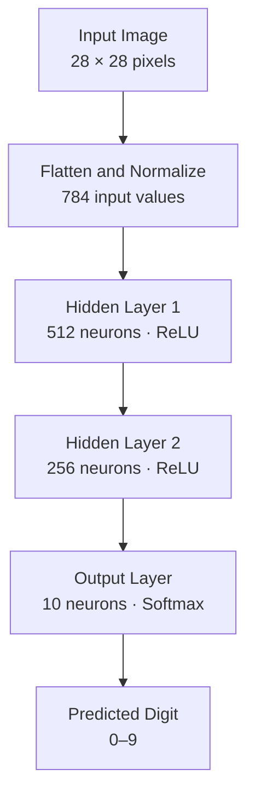

# Handwritten Digit Recognition using ANN in C

A handwritten digit classification system built from scratch in C using an Artificial Neural Network (ANN). The project explores the fundamentals of neural networks by implementing forward propagation, backpropagation, activation functions, weight updates, model persistence, and prediction without relying on high-level machine learning frameworks.

The model is trained and evaluated using the MNIST handwritten digit dataset, which contains grayscale images of digits from 0 to 9.

## ✨ Key Features

- **Neural Network from Scratch:** Implements a fully connected artificial neural network in C.
- **Two Hidden Layers:** Uses 512 and 256 neurons with ReLU activation.
- **Softmax Classification:** Produces class probabilities for digits 0–9.
- **MNIST Training and Evaluation:** Supports the standard training and test datasets.
- **Model Persistence:** Saves and loads trained weights and biases using a binary file.
- **Custom Image Prediction:** Accepts a preprocessed 28 × 28 grayscale image in raw binary format.
- **Learning Rate Scheduling:** Uses a decaying learning rate during training.
- **Manual Memory and File Handling:** Implements dataset loading and model storage using C file I/O.

## 🛠️ Tech Stack

| Component               | Technology                                               |
| ----------------------- | -------------------------------------------------------- |
| Programming Language    | C                                                        |
| Neural Network          | Fully connected ANN                                      |
| Hidden Layer Activation | ReLU                                                     |
| Output Activation       | Softmax                                                  |
| Loss Function           | Negative log-likelihood for the target class             |
| Training Method         | Stochastic gradient descent, as documented in the report |
| Dataset                 | MNIST                                                    |
| Compiler                | GCC                                                      |

No high-level machine learning frameworks such as TensorFlow or PyTorch are used in the C implementation.

## 🧠 Neural Network Architecture

The network uses two hidden layers to learn representations of handwritten digit images.

| Layer          | Neurons | Activation |
| -------------- | ------: | ---------- |
| Input          |     784 | None       |
| Hidden Layer 1 |     512 | ReLU       |
| Hidden Layer 2 |     256 | ReLU       |
| Output         |      10 | Softmax    |

### Architecture Diagram



### Forward Propagation

The input image is flattened into a vector of 784 pixel intensities and normalized to the range 0–1.

The hidden layers compute weighted sums followed by ReLU activation:

[
a^{(1)}=\operatorname{ReLU}(W^{(1)}x+b^{(1)})
]

[
a^{(2)}=\operatorname{ReLU}(W^{(2)}a^{(1)}+b^{(2)})
]

The output layer computes class probabilities using softmax:

[
\hat y=\operatorname{softmax}(W^{(3)}a^{(2)}+b^{(3)})
]

The class with the highest predicted probability is selected as the recognized digit.

## 📊 Dataset

The project uses the MNIST handwritten digit dataset.

| Dataset Split     | Number of Images |
| ----------------- | ---------------: |
| Training          |           60,000 |
| Testing           |           10,000 |
| Image Dimensions  |   28 × 28 pixels |
| Number of Classes |               10 |

Each image contains grayscale pixel values representing a handwritten digit from 0 through 9.

### Required Dataset Files

Place the following files in the same directory as the compiled program:

```text
train-images.idx3-ubyte
train-labels.idx1-ubyte
t10k-images.idx3-ubyte
t10k-labels.idx1-ubyte
```

The files use the original MNIST IDX binary format.

## ⚙️ Training and Evaluation

The implementation includes the following stages:

1. Initialize the network weights and biases.
2. Load the MNIST training images and labels.
3. Perform forward propagation through the network.
4. Calculate the classification loss.
5. Apply backpropagation and update the weights and biases.
6. Reduce the learning rate according to the configured schedule.
7. Save the trained model to `10k.bin`.
8. Evaluate the model on the MNIST test set.

### Configuration

| Parameter             | Value |
| --------------------- | ----: |
| Input Size            |   784 |
| Hidden Layer 1        |   512 |
| Hidden Layer 2        |   256 |
| Output Classes        |    10 |
| Initial Learning Rate | 0.001 |
| Configured Batch Size |    64 |
| Epochs                |   100 |

The current implementation processes training examples individually; the configured batch-size constant is not used for mini-batch updates.

## 📈 Results

The accompanying project report records the following test-set result:

| Metric              | Reported Result |
| ------------------- | --------------: |
| Test Images         |          10,000 |
| Correct Predictions |           8,905 |
| Test Accuracy       |          89.05% |

The report also includes class-wise precision, recall, F1-scores, and a 10 × 10 confusion matrix.

These additional metrics are documented in the report; the C source version should be checked before assuming that all of them are generated by the executable.

## 💾 Model Saving and Loading

The trained network parameters are stored in a binary file:

```text
10k.bin
```

The file contains the weights and biases for all three trainable layers.

If the model file exists, the program loads the saved parameters rather than training the network again. Otherwise, it initializes the weights, trains the model, and saves the resulting parameters.

## 🚀 Getting Started

### Prerequisites

- GCC or another compatible C compiler
- The four MNIST IDX dataset files
- A terminal or command prompt

### 1. Clone the Repository

```bash
git clone YOUR_REPOSITORY_URL
cd YOUR_REPOSITORY_DIRECTORY
```

Replace the placeholders with your actual GitHub repository URL and directory name.

### 2. Compile the Program

If your source file is named `main.c`, compile it with:

```bash
gcc main.c -o digit_recognition -lm
```

The `-lm` flag links the C math library, which is required for mathematical operations such as exponentiation and square roots.

### 3. Train and Evaluate

Ensure that the MNIST dataset files are in the current working directory, then run:

```bash
./digit_recognition
```

If `10k.bin` does not exist, the program initializes the network, trains it for the configured number of epochs, saves the model, and evaluates it on the test dataset.

If `10k.bin` already exists, the program loads the saved model and evaluates it.

On Windows, the executable can be run as:

```powershell
.\digit_recognition.exe
```

### 4. Predict a Custom Digit

The program accepts a raw binary image containing 784 grayscale pixel values.

The input must be:

- Grayscale
- 28 × 28 pixels
- Stored as 784 raw pixel bytes
- Preprocessed consistently with the MNIST images

Run:

```bash
./digit_recognition predict path/to/digit.raw
```

The program prints the predicted digit.

**Note:** Standard PNG and JPEG files cannot be passed directly to this command. They must first be converted into the expected raw grayscale format.

## 📁 Project Structure

A suggested repository structure is:

```text
handwritten-digit-recognition/
├── main.c
├── README.md
├── train-images.idx3-ubyte
├── train-labels.idx1-ubyte
├── t10k-images.idx3-ubyte
├── t10k-labels.idx1-ubyte
└── 10k.bin
```

Dataset files and the trained model are runtime assets. They do not necessarily need to be committed to GitHub; the repository can instead document how to obtain the dataset and generate the model.

## 🎯 Learning Outcomes

This project explores:

- Neural network implementation without high-level ML frameworks
- Forward propagation and activation functions
- Backpropagation and gradient-based parameter updates
- Softmax-based multiclass classification
- Binary dataset parsing and file I/O in C
- Model serialization and inference
- Evaluation of a machine learning classifier

## 🔮 Future Improvements

- Add a visual interface for drawing digits and displaying predictions.
- Generate training-loss and accuracy plots.
- Improve the training implementation and validate gradient calculations.
- Add reproducible training configurations and model evaluation.
- Support standard image formats through a preprocessing pipeline.

## 👤 Contributors

**Shaunak Sathaye**

**Ridham Shah**

**Aarussh Shrivastava**

**Aditya Chhajed**

